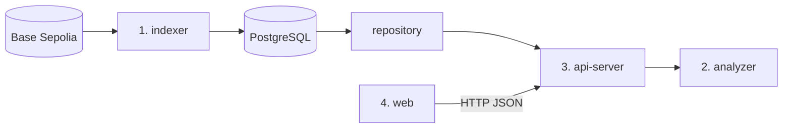

# SKKRYPTO Tracker

정해진 데이터 범위(Base Sepolia, ERC-20 토큰 하나, 확정된 블록 구간) 안에서 **주소와 주소 사이의 토큰 이동 경로**를 찾고, 그렇게 판단한 **근거(전송 기록)** 까지 함께 보여 주는 서비스입니다. 성균관대 블록체인 학회 SKKRYPTO 개발팀 프로젝트입니다.

> 후보 연결은 동일 자금의 귀속을 확정하지 않습니다. 패턴은 규칙 일치이며 소유자나 위법성을 판정하지 않습니다.

## 구성

| 폴더 | 담당 | 내용 |
|---|---|---|
| `src/backend` | 1·2·3 | 백엔드 Go 모듈(`go.mod` 하나). 아래 네 폴더가 같은 모듈이라 공통 타입을 바로 가져다 쓴다 |
| `src/backend/indexer` | 1. 인덱서·DB | 온체인 데이터를 수집해 DB에 저장, 수집 대상 토큰 목록(`tokens.json`) |
| `src/backend/domain` | 1·2·3 공통 | 전송·자산·위치·금액 타입 |
| `src/backend/analyzer` | 2. 분석 엔진 | 시간순 경로(BFS)와 분산·합류 패턴 → [탐지 기준·한계](src/backend/analyzer/README.md) |
| `src/backend/api-server` | 3. API 서버 | HTTP API·규격·저장소(Fixture·PostgreSQL) → [실행·구조](src/backend/api-server/README.md), [규격](src/backend/api-server/contracts/README.md) |
| `src/database` | 1. 인덱서·DB | PostgreSQL 스키마(`init.d`)·되돌리기(`rollback`) → [도메인 모델](src/database/domain-model.md), [ERD](src/database/erd.md) |
| `src/web` | 4. 웹 | 분석 결과 화면 |



자세한 구조와 경계는 [코드 구조](src/backend/api-server/docs/architecture.md)에 있습니다.

## 빠르게 실행하기

필요한 것: Go 1.23 이상(`src/backend/go.mod` 기준). (선택) Docker Compose v2.24 이상

Go 명령은 모듈 루트인 `src/backend`에서 실행합니다. 아래 `make` 명령은 레포 루트에서 치면 알아서 그 폴더에서 돌립니다.

```bash
make check      # PR 올리기 전 검사(CI의 backend 검사와 같은 gofmt·vet·go test -race)
make run-api    # 합성 Fixture 데이터로 API 실행(http://localhost:8080)
```

```bash
curl -s localhost:8080/api/datasets

curl -s -X POST localhost:8080/api/paths \
  -H 'Content-Type: application/json' \
  -d '{"datasetId":"flow-demo","datasetVersion":"v1",
       "address":"0x0000000000000000000000000000000000000001",
       "targetAddress":"0x0000000000000000000000000000000000000007","maxDepth":3}'
```

```bash
cp src/database/.env.example src/database/.env   # 처음 한 번: DB 계정
docker compose up --build -d                       # API(8080)·Swagger UI(8081)·PostgreSQL(내부 전용)
docker compose --profile debug up -d               # 위에 더해 pgweb(8082): 브라우저에서 DB 보기
make help                                          # 명령 목록
```

포트는 이 컴퓨터(127.0.0.1)에서만 열리고, PostgreSQL은 포트를 열지 않아 DB 내용은 pgweb으로 봅니다. 포트 바꾸기·데이터 지우기는 `docker-compose.yml` 맨 위 주석에 있습니다. API는 기본으로 Fixture를 읽고, `DATABASE_URL`을 주면 PostgreSQL을 읽습니다([DB로 실행하기](src/backend/api-server/README.md#db로-실행하기)).

## API

| API | 하는 일 |
|---|---|
| `GET /api/datasets` | 데이터셋 목록 |
| `GET /api/datasets/{id}` | 한 버전의 상태·자산·범위 |
| `GET /api/transfers` | 전송 목록(주소·방향·범위 필터, 커서) |
| `GET /api/transactions/{txHash}` | 한 거래 안의 전송 |
| `POST /api/trace` | 시작 주소에서 1~3 hop 시간순 추적 |
| `POST /api/paths` | 두 주소 사이 시간순 후보 경로 |
| `POST /api/patterns` | 분산(FAN_OUT)·합류(FAN_IN) 패턴 |

규격은 [`src/backend/api-server/contracts/openapi.json`](src/backend/api-server/contracts/openapi.json)이 기준이고, 요청·응답 예시는 같은 폴더의 `samples/`에 있습니다. 사용법 설명은 [API 문서](src/backend/api-server/docs/README.md)에 있습니다.

배포된 API(Railway, 싱가포르): `https://api-production-965fc.up.railway.app` (예: `curl -s https://api-production-965fc.up.railway.app/api/datasets`). 배포 설정은 [API 서버 문서](src/backend/api-server/README.md#배포railway)에 있습니다.

## 협업 규칙

규칙의 기준은 [개발 규칙](docs/conventions.md), 리뷰 기준은 [REVIEW.md](REVIEW.md)입니다. 자주 찾는 것만 요약합니다.

- **흐름:** main에서 짧게 브랜치를 따서 PR → 승인 1명과 리뷰 대화 모두 resolve → **Squash merge**. main에 직접 push하지 않고, 합친 브랜치는 지웁니다.
- **이름:** 브랜치는 `종류/issue-번호-작업-내용`(예: `feature/issue-12-trace-api`), PR 제목은 `종류(범위): 설명`(예: `feat(api): 후보 경로 응답에 잘림 사유 추가`). Squash merge라 PR 제목이 main의 커밋 제목이 됩니다. 규격을 깨는 변경은 `feat(contract)!:`처럼 `!`를 붙입니다.
- **자동 검사:** CI가 PR마다 backend(gofmt·vet·`go test -race`)·web(lint·build)·database(migration up → rollback → up)와 PR 제목·브랜치 이름을 봅니다. 올리기 전에 `make check`로 backend 검사를 미리 돌립니다.
- **리뷰:** PR 댓글에 `@coderabbitai review`를 남기면 CodeRabbit 리뷰를 받습니다. 지적마다 "고침" 또는 "안 고침 + 이유"로 답하고 resolve합니다. 리뷰어는 [`.github/CODEOWNERS`](.github/CODEOWNERS)가 바뀐 폴더에 맞춰 자동으로 요청합니다(기본 짝 1↔2, 3↔4).
- **비밀값:** 키·비밀번호는 `.env`에만 두고 커밋하지 않습니다(`.env.example`에는 이름만). 실수로 올렸다면 커밋을 지워도 기록에 남으므로 그 키를 바로 폐기하고 새로 발급받습니다. 실습 정답은 이 public 저장소가 아니라 조직의 private 저장소에 둡니다.

## 문서

- [docs/](docs/README.md): 프로젝트 문서(범위·사용자 흐름·구조·정확성 기준·역할·구현 순서·개발 규칙·대상 토큰)
- [src/database/domain-model.md](src/database/domain-model.md)·[erd.md](src/database/erd.md): 수집 도메인 모델과 DB 테이블
- [src/backend/api-server/docs/architecture.md](src/backend/api-server/docs/architecture.md): 코드 구조, 경계, 요청 흐름, 버전
- [src/backend/analyzer/README.md](src/backend/analyzer/README.md): 경로·패턴 판단 기준과 한계
- [src/backend/api-server/README.md](src/backend/api-server/README.md): 실행, 환경 변수, 안전장치, DB로 실행하기, 배포
- [src/backend/api-server/contracts/README.md](src/backend/api-server/contracts/README.md): API 규격과 샘플
- [src/backend/api-server/docs/](src/backend/api-server/docs/README.md): API 문서(사용법, API별 페이지, 오류 처리)

## 라이선스

[Apache License 2.0](LICENSE)을 따릅니다. 저작권 표기는 [NOTICE](NOTICE)에 있습니다.
