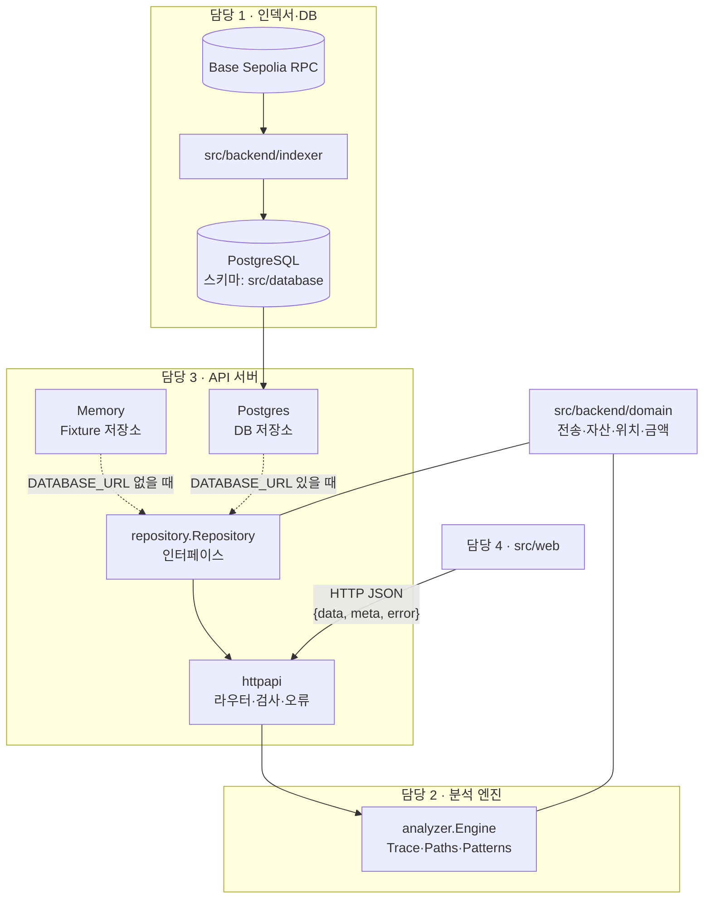
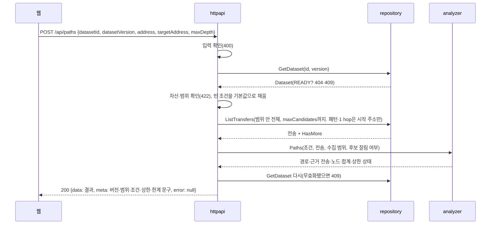

# 코드 구조

담당 2·3 코드(`src/backend/domain`·`src/backend/analyzer`·`src/backend/api-server`)의 경계와 요청 흐름입니다. 기획 수준의 전체 구조와 기술 스택은 프로젝트 문서(`docs/`)의 '구조와 기술 스택'에 있습니다.

## 한눈에 보기

## 경계와 의존 방향

| 패키지 | 아는 것 | 모르는 것 |
|---|---|---|
| `src/backend/domain` | 전송·자산·위치·금액 | 그 밖의 모든 것 |
| `src/backend/analyzer` | domain | DB·RPC·HTTP |
| `src/backend/api-server/repository` | domain (PostgreSQL 구현은 pgx) | HTTP·엔진 |
| `src/backend/api-server/httpapi` | domain·analyzer·repository(인터페이스) | 실제 DB 종류 |
| `src/backend/api-server/cmd/api-server` | 전부(조립만 함: `DATABASE_URL`로 저장소 고르기) | |

- **엔진이 DB를 모르는 이유:** 작은 가짜 데이터로 바로 테스트할 수 있고, 같은 입력이면 같은 결과가 나옵니다. DB가 바뀌어도 엔진은 그대로입니다.
- **API가 인터페이스만 아는 이유:** 저장소는 Fixture 메모리 저장소와 PostgreSQL 저장소 두 가지이고, `cmd/api-server/main.go` 한 곳에서 `DATABASE_URL`을 보고 하나를 골라 넘깁니다. 그래서 DB 없이도 같은 코드로 개발·테스트할 수 있습니다.
- **공통 타입을 따로 둔 이유:** 수집·엔진·API가 같은 Transfer를 써야 ID·위치·금액 규칙이 어긋나지 않습니다. 공통 패키지에는 꼭 같이 써야 하는 것만 둡니다.

## 분석 요청 한 번의 흐름(POST /api/paths)

## 세 가지 버전

| 버전 | 어디에 | 바뀌면 |
|---|---|---|
| `contractVersion` (v1) | API 응답 모양 | 웹이 파싱 코드를 고쳐야 함 |
| `ruleVersion` (flow-v1) | 경로·패턴 판단 규칙 | 같은 데이터라도 결과가 달라질 수 있음 |
| `datasetVersion` | 데이터셋 내용 | 다른 데이터. READY가 된 버전은 내용이 바뀌지 않음 |

응답 `meta`에 세 버전과 실제로 쓴 조건(`conditions`)이 모두 실리므로, 응답 JSON 하나만 저장해 두면 같은 결과를 다시 만들 수 있습니다(JSON 내보내기).

## 규격을 먼저 정하는 방식

1. `src/backend/api-server/contracts/openapi.json`에 요청·응답 모양을 먼저 적습니다.
2. `src/backend/api-server/contracts/samples/`의 샘플로 웹은 서버 없이도 화면을 만들 수 있습니다.
3. 서버 테스트(`TestResponsesMatchSamples`)가 실제 응답이 샘플과 글자 그대로 같은지 확인하고, CI의 backend 검사가 PR마다 이 테스트를 돌립니다. openapi.json의 깨지는 변경은 CodeRabbit 리뷰(oasdiff)가 알려 줍니다.
4. 그래서 서버와 샘플이 어긋나면 PR 단계에서 바로 드러납니다. 규격을 바꿀 때는 openapi.json과 샘플을 같은 PR에서 함께 고칩니다.
