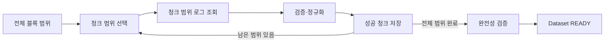
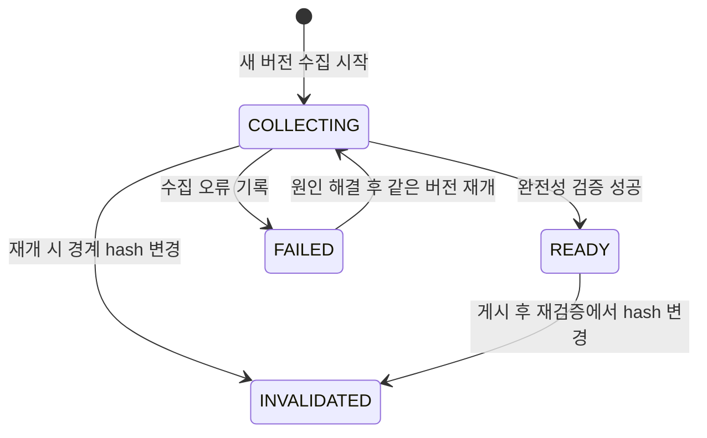
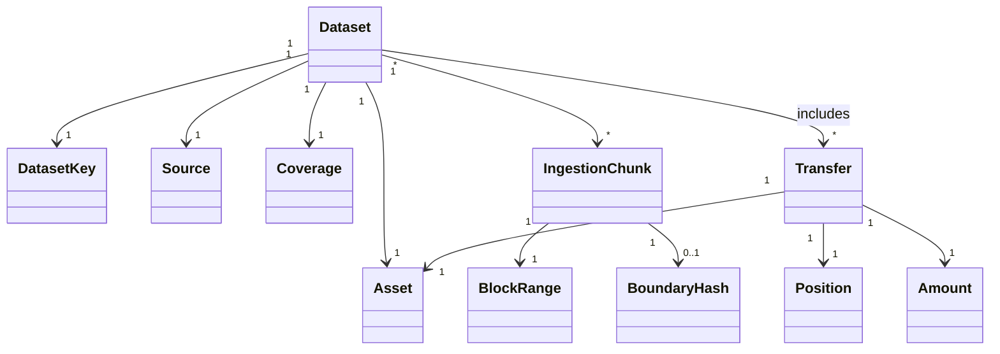

# Indexer 도메인 모델

## 목적과 범위

이 문서는 Fixture 또는 RPC에서 ERC-20 `Transfer`를 수집해 재현 가능한 `Dataset`으로 게시하는 과정을 도메인 개념과 관계로 설명합니다.

이 문서에서는 다음 설계 결정에 집중합니다:

- 핵심 개념과 식별 기준
- Entity와 Value Object의 구분
- Entity, Value Object 간 관계
- 불변식과 상태 전이

## 공통 언어

| 개념 | 의미 |
| --- | --- |
| `Collection` | 하나의 수집 요청을 실행해 Dataset을 만드는 과정 |
| `CollectionSpec` | 수집 원천·자산·블록 범위를 담은 입력 값 |
| `Dataset` | 원천·자산·범위·내용이 고정된 수집 결과 한 벌 |
| `DatasetKey` | `datasetId + datasetVersion`으로 Dataset 한 버전을 가리키는 값 |
| `Source` | `sourceMode + sourceNamespace`로 Fixture와 Snapshot을 구분하는 값 |
| `Asset` | `chainId + tokenAddress`로 식별하는 ERC-20 자산 |
| `Coverage` | Dataset이 포함하는 시작·종료 블록과 시각의 범위 |
| `Transfer` | ERC-20 `Transfer` 이벤트 하나를 정규화한 기록 |
| `Position` | `blockNumber + transactionIndex + logIndex`로 나타낸 체인 안의 위치 |
| `IngestionChunk` | Dataset 범위의 일부를 성공적으로 원자 커밋한 기록 |
| `BoundaryHash` | Snapshot 재개 시 사용하는 청크 마지막 블록의 번호와 hash |

`Collection`은 과정이고 `CollectionSpec`은 그 과정의 입력이므로 Entity로 취급하지 않습니다.

## 도메인 모델

### Entity

#### Dataset

- 식별자: `DatasetKey(datasetId, datasetVersion)`
- 하나의 `Source`, `Asset`, `Coverage`와 상태를 가집니다.
- Snapshot은 수집 시작 시점에 확인한 `finalizedBlock`을 기록합니다.
- 수집 진행과 게시 가능 여부를 관리하는 중심 Entity입니다.
- `READY`가 된 버전의 내용은 변경하지 않습니다.
- 상태는 다음과 같이 정의합니다:

| 상태 | 의미 |
| --- | --- |
| `COLLECTING` | 수집 중이거나 재개 가능한 중단 상태 |
| `READY` | 전체 범위 검증을 통과해 조회·분석 가능한 상태 |
| `FAILED` | 오류를 기록하고 진행을 중단한 미게시 상태 |
| `INVALIDATED` | 원천 일관성이 깨져 조회·분석에 사용할 수 없는 상태 |

- 갑작스러운 중단은 상태를 변경할 수 없으므로 `COLLECTING`으로 남습니다.
- `READY`와 `INVALIDATED`는 다시 `COLLECTING`으로 되돌리지 않습니다.
- `INVALIDATED` 이후 재수집은 새 Dataset 버전으로 시작합니다.

#### Transfer

- 식별자: `TransferID`
- Snapshot Transfer ID: `{chainId}:{txHash}:{logIndex}`
- Fixture Transfer ID: `fx:{namespace}:{recordId}`
- Dataset과 독립적으로 식별하며, 같은 원천 전송은 Dataset이나 버전이 달라도 같은 ID를 가집니다.
- 자신이 어떤 토큰의 전송인지 나타내는 `Asset`을 가집니다.

#### IngestionChunk

- 식별자: `ChunkID`
- 하나의 Dataset 버전에 속하며, Dataset 전체 범위 중 연속된 블록 구간 `BlockRange`를 담당합니다.
- 성공적으로 커밋된 청크만 Entity로 저장합니다.
- Snapshot 청크는 종료 블록에 해당하는 Block의 hash를 `BoundaryHash`로 사용합니다.

### Value Object

| 개념 | 동등성 | 불변식 |
| --- | --- | --- |
| `DatasetKey` | `datasetId + datasetVersion` | 두 값이 모두 있어야 함 |
| `Source` | `sourceMode + sourceNamespace` | `FIXTURE` 또는 `SNAPSHOT` |
| `Coverage` | 시작·종료 블록과 시각 | 시작이 종료보다 뒤일 수 없음 |
| `BlockRange` | `startBlock + endBlock` | `startBlock <= endBlock` |
| `Asset` | `chainId + tokenAddress` | 자산의 표시 정보와 식별 정보를 구분 |
| `Position` | `blockNumber + transactionIndex + logIndex` | 원천 로그 위치를 보존 |
| `Amount` | uint256 정수 값 | decimals 적용 전 원시 값, float 금지 |
| `BoundaryHash` | `blockNumber + blockHash` | 청크 종료 블록과 일치 |

## 관계와 집합 경계

- 블록과 거래의 물리적 저장 구조는 ERD에서 결정합니다.

## 핵심 불변식

### 청크와 재개

- 동일한 `DatasetKey`에 대한 Collection은 동시에 하나만 활성화될 수 있습니다.
- 먼저 블록 청크 범위를 정하고 해당 범위의 로그를 읽습니다.
- 청크 범위는 Dataset 범위 안에 있어야 하며, 같은 Dataset 버전의 성공 청크끼리 겹치지 않아야 합니다.
- 실패하거나 커밋되지 않은 시도는 `IngestionChunk`로 남기지 않습니다.
- 마지막 성공 청크까지 범위가 연속적일 때 그 청크의 `endBlock + 1`부터 재개합니다.
- Snapshot은 재개 전에 마지막 성공 청크의 `BoundaryHash`를 현재 RPC와 대조합니다.
- Fixture에는 RPC의 finality나 블록 hash 재검증을 적용하지 않고 고정된 버전과 namespace로 동일성을 구분합니다.
- 청크 크기를 바꾸거나 범위를 분할해도 Transfer ID와 최종 Dataset 내용은 달라지지 않아야 합니다.

### 게시와 버전

Dataset은 다음 조건을 모두 만족할 때만 `READY`가 될 수 있습니다.

1. Dataset 시작 블록부터 종료 블록까지 성공 청크가 빈틈없이 이어집니다.
2. 성공 청크 범위가 서로 겹치지 않습니다.
3. 필요한 데이터와 Dataset–Transfer 관계가 모두 커밋되었습니다.
4. Snapshot의 경계 hash 검증이 성공했습니다.

- 조회와 분석에는 `READY` Dataset만 사용합니다.
- 단순 재시도, 프로세스 재시작과 청크 크기 변경은 같은 미게시 버전에서 진행합니다.
- Snapshot의 경계 hash가 달라지면 해당 버전을 `INVALIDATED`로 전환하고 새 버전으로 재수집합니다.
- Fixture 내용이 바뀌는 경우에도 기존 버전을 덮어쓰지 않고 새 버전을 만듭니다.
- `READY`와 `INVALIDATED` 버전의 기존 내용은 변경하지 않습니다.

## 근거 문서

- [구조와 기술 스택](../../../docs/architecture.md)
- [정확성·보안 기준](../../../docs/correctness-security.md)
- [역할 분담](../../../docs/roles.md)
- [공통 도메인 타입](../domain/)
