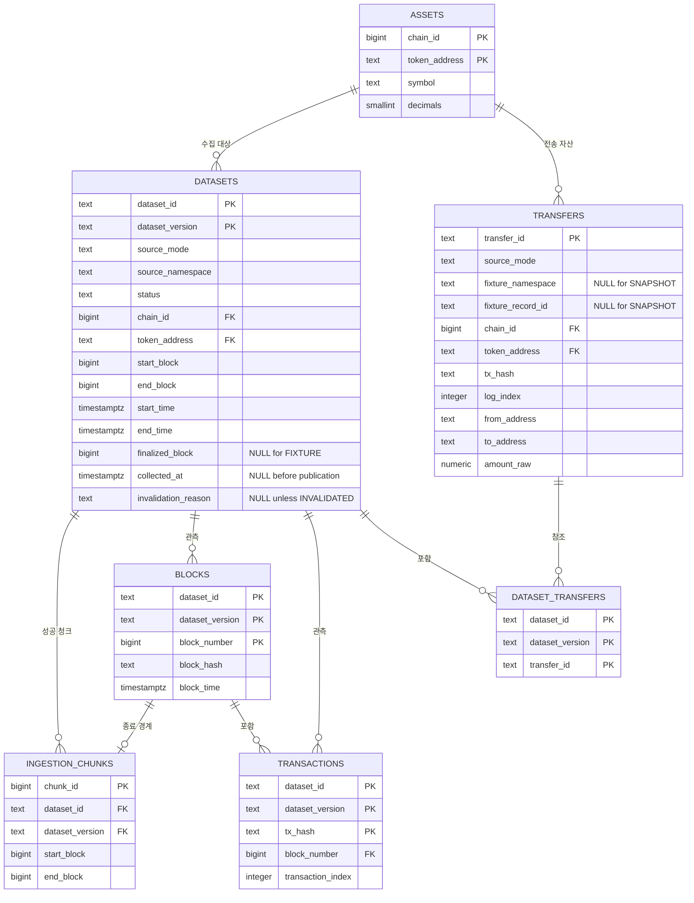

# Indexer ERD

## 목적

이 문서는 [Indexer 도메인 모델](./domain-model.md)의 ERD 입니다.

## 관계

별도로 `NULL`이라고 표시한 컬럼을 제외한 모든 컬럼은 `NOT NULL`입니다. PK 컬럼은 자동으로 `NOT NULL`입니다. 다이어그램에서 같은 테이블의 여러 컬럼에 붙은 `FK` 표시는 각 컬럼이 독립된 FK라는 뜻이 아니라, 테이블별 설명에 적은 하나의 복합 FK를 구성할 수 있습니다.

## 테이블별 설계

### `assets`

ERC-20 자산의 식별 정보와 표시 정보를 저장합니다.

| 컬럼 | 타입 | 제약·의미 |
| --- | --- | --- |
| `chain_id` | `BIGINT` | PK, 양수. Base Sepolia는 `84532` |
| `token_address` | `TEXT` | PK, 소문자 EVM 주소 |
| `symbol` | `TEXT` | 표시용 심볼 |
| `decimals` | `SMALLINT` | `0 <= decimals <= 255` |

Dataset과 Transfer는 모두 이 테이블의 동일한 자산을 참조합니다.

한 번 참조된 자산의 `symbol`과 `decimals`는 변경하지 않습니다. 같은 자산 키로 다른 값이 들어오면 기존 행을 갱신하지 않고 원천 불일치 오류로 처리합니다.

### `datasets`

Dataset 한 버전의 원천, 범위와 게시 상태를 저장합니다.

| 컬럼 | 타입 | 제약·의미 |
| --- | --- | --- |
| `dataset_id` | `TEXT` | 복합 PK |
| `dataset_version` | `TEXT` | 복합 PK |
| `source_mode` | `TEXT` | `FIXTURE`, `SNAPSHOT` 중 하나 |
| `source_namespace` | `TEXT` | 원천 namespace |
| `status` | `TEXT` | `COLLECTING`, `READY`, `FAILED`, `INVALIDATED` 중 하나 |
| `chain_id`, `token_address` | `BIGINT`, `TEXT` | `NOT NULL`, `assets` 복합 FK |
| `start_block`, `end_block` | `BIGINT` | Dataset Coverage의 블록 범위 |
| `start_time`, `end_time` | `TIMESTAMPTZ` | Dataset Coverage의 UTC 시각 범위 |
| `finalized_block` | `BIGINT NULL` | Snapshot 수집 시작 시 고정한 상한. Fixture는 `NULL` |
| `collected_at` | `TIMESTAMPTZ NULL` | `READY` 게시가 완료된 시각 |
| `invalidation_reason` | `TEXT NULL` | `INVALIDATED` 원인 |

Fixture의 `source_namespace`는 Transfer ID의 namespace로 사용하며 Dataset 버전이 바뀌어도 유지합니다. 버전은 `dataset_version`으로만 구분합니다.

필수 제약은 다음과 같습니다.

- `start_block <= end_block`
- 모든 블록 번호는 0 이상
- `start_time <= end_time`
- Snapshot은 `finalized_block IS NOT NULL`이고 `end_block <= finalized_block`
- Fixture는 `finalized_block IS NULL`
- `READY`이면 `collected_at IS NOT NULL`
- `INVALIDATED`이면 `invalidation_reason IS NOT NULL`

### `ingestion_chunks`

성공적으로 커밋된 청크만 저장합니다. 실패 시도와 분할 전 부모 범위는 저장하지 않습니다.

| 컬럼 | 타입 | 제약·의미 |
| --- | --- | --- |
| `chunk_id` | `BIGINT GENERATED ALWAYS AS IDENTITY` | PK, 내부 식별자 |
| `dataset_id`, `dataset_version` | `TEXT` | `NOT NULL`, `datasets` 복합 FK |
| `start_block`, `end_block` | `BIGINT` | `NOT NULL`, 성공한 청크의 폐구간 |

청크 범위는 Dataset 범위 안에 있어야 하고 `start_block <= end_block`이어야 합니다. 같은 Dataset 버전의 성공 청크 범위는 겹치면 안 됩니다.

이를 보장하기 위해, Repository는 청크 커밋 트랜잭션 안에서 Dataset 행을 `FOR UPDATE`로 잠그고 기존 범위와의 중복을 확인한 뒤 INSERT합니다. `READY` 전환 전에도 전체 범위의 비중복과 연속성을 다시 검증합니다.

다음 복합 FK로 종료 블록이 같은 Dataset 버전에 속하는지 확인합니다.

- `(dataset_id, dataset_version, end_block)` → `blocks(dataset_id, dataset_version, block_number)`

### `blocks`

Dataset 버전이 관측한 블록 번호, hash와 시각을 저장합니다.

| 컬럼 | 타입 | 제약·의미 |
| --- | --- | --- |
| `dataset_id`, `dataset_version`, `block_number` | `TEXT`, `TEXT`, `BIGINT` | 복합 PK, `datasets` FK |
| `block_hash` | `TEXT` | 소문자 블록 hash |
| `block_time` | `TIMESTAMPTZ` | `block.timestamp` |

블록을 Dataset 버전에 종속시킨 이유는 같은 블록 번호의 hash가 변경되더라도 이전 Dataset 버전의 관측 내용을 덮어쓰지 않기 위해서입니다. 적어도 Dataset 경계 블록, 각 청크의 종료 블록과 Transfer가 발생한 블록은 저장합니다.

`block_number`는 0 이상이고, `block_hash`는 `0x` 접두어를 포함한 소문자 32-byte hash 형식이어야 합니다.

### `transactions`

Dataset 버전에서 Transfer가 발생한 거래를 저장합니다. Receipt 성공 여부는 수집 단계에서 검증하며 별도 컬럼으로 저장하지 않습니다.

| 컬럼 | 타입 | 제약·의미 |
| --- | --- | --- |
| `dataset_id`, `dataset_version`, `tx_hash` | `TEXT`, `TEXT`, `TEXT` | 복합 PK, `datasets` FK |
| `block_number` | `BIGINT` | `NOT NULL`, 같은 Dataset 버전의 `blocks` 복합 FK |
| `transaction_index` | `INTEGER` | 블록 안의 거래 위치, 0 이상 |

`(dataset_id, dataset_version, block_number, transaction_index)`에는 UNIQUE 제약을 둡니다.

### `transfers`

Dataset과 독립적인 Transfer ID와 전송 내용을 저장합니다.

| 컬럼 | 타입 | 제약·의미 |
| --- | --- | --- |
| `transfer_id` | `TEXT` | PK, 외부에 노출하는 원천 기반 ID |
| `source_mode` | `TEXT` | `FIXTURE`, `SNAPSHOT` |
| `fixture_namespace`, `fixture_record_id` | `TEXT NULL` | Fixture 원천 키. Snapshot은 `NULL` |
| `chain_id`, `token_address` | `BIGINT`, `TEXT` | `NOT NULL`, `assets` 복합 FK |
| `tx_hash` | `TEXT` | 거래 hash |
| `log_index` | `INTEGER` | 로그 위치, 0 이상 |
| `from_address`, `to_address` | `TEXT` | 소문자 EVM 주소 |
| `amount_raw` | `NUMERIC(78,0)` | decimals 적용 전 원시 uint256 |

중복 방지 제약은 원천별로 나눕니다.

- Snapshot: `(chain_id, tx_hash, log_index)` partial UNIQUE
- Fixture: `(fixture_namespace, fixture_record_id)` partial UNIQUE
- Fixture는 `fixture_namespace`, `fixture_record_id`가 모두 `NOT NULL`
- Snapshot은 `fixture_namespace`, `fixture_record_id`가 모두 `NULL`
- `0 <= amount_raw <= 2^256 - 1`

주소는 `0x` 접두어를 포함한 소문자 20-byte 형식, `tx_hash`는 `0x` 접두어를 포함한 소문자 32-byte 형식이어야 합니다. Snapshot과 Fixture의 `transfer_id`는 각각 정해진 원천 ID 규칙으로 생성하고 Repository가 구성 필드와의 일치를 검증합니다.

`transfer_id`로 충돌한 재수집 데이터의 자산·주소·금액이 기존 값과 다르면 기존 행을 덮어쓰지 않고 원천 불일치 오류로 처리합니다.

전송 유형은 `from_address`와 `to_address`로 계산하며 DB에 중복 저장하지 않습니다. Fixture 표시 이름이 필요하면 `fixture_record_id`를 사용합니다.

### `dataset_transfers`

Dataset 버전과 Transfer의 다대다 포함 관계를 저장합니다.

| 컬럼 | 타입 | 제약·의미 |
| --- | --- | --- |
| `dataset_id`, `dataset_version`, `transfer_id` | `TEXT` | 복합 PK, 각각 Dataset·Transfer FK |

연결되는 Transfer의 `source_mode`와 `Asset`은 Dataset의 값과 같아야 합니다. Fixture라면 Transfer의 `fixture_namespace`도 Dataset의 `source_namespace`와 같아야 합니다. 연결 테이블에 이 값들을 중복 저장하지 않으므로 Repository가 같은 트랜잭션에서 검증하고 계약 테스트로 고정합니다.

복합 PK로 같은 Dataset 버전에 같은 Transfer가 두 번 연결되는 것을 막습니다. Repository는 Transfer의 `tx_hash`와 같은 Dataset 버전의 Transaction이 존재하는지, 같은 Dataset 버전에 동일한 전송 위치가 중복되지 않는지도 검증합니다. 전송 위치는 두 테이블을 조인해 구성합니다.

## 인덱스

| 목적 | 인덱스 |
| --- | --- |
| READY Dataset 조회 | `datasets(status, dataset_id, dataset_version)` |
| 자산별 Dataset | `datasets(chain_id, token_address, status)` |
| Dataset 청크 순서 | `ingestion_chunks(dataset_id, dataset_version, start_block)` |
| Tx Hash 검색 | `transfers(chain_id, tx_hash)` |
| 송신 주소 검색 | `transfers(chain_id, token_address, from_address)` |
| 수신 주소 검색 | `transfers(chain_id, token_address, to_address)` |
| Transfer가 포함된 Dataset 조회 | `dataset_transfers(transfer_id, dataset_id, dataset_version)` |
| Dataset 거래 위치 정렬 | `transactions(dataset_id, dataset_version, block_number, transaction_index)` |

주소 검색은 `transfers`에서 대상 ID를 찾고 `dataset_transfers`로 Dataset 버전을 제한합니다.

## 트랜잭션과 재개

한 청크의 DB 트랜잭션에는 다음 작업을 함께 넣습니다.

1. 필요한 `blocks` insert 또는 기존 행 동일성 확인
2. 필요한 `transactions` upsert
3. `transfers` insert 또는 동일성 확인
4. `dataset_transfers` insert
5. `ingestion_chunks` insert

하나라도 실패하면 전체를 rollback합니다. RPC 호출과 디코딩은 이 트랜잭션을 시작하기 전에 끝냅니다.

같은 Dataset 버전과 블록 번호의 `blocks` 행이 이미 있으면 `block_hash`와 `block_time`이 모두 같은지 확인합니다. 값이 다르면 기존 행을 갱신하지 않고 원천 불일치로 처리합니다. Snapshot의 hash가 달라진 경우 해당 Dataset 버전을 `INVALIDATED`로 전환하고 새 버전으로 재수집합니다.

재개할 때는 `ingestion_chunks`를 `start_block` 순으로 읽어 Dataset 시작 블록부터 이어지는 마지막 청크를 찾습니다. 같은 Dataset 버전의 `blocks`에서 그 청크의 `end_block`에 해당하는 `block_hash`를 조회해 RPC와 대조한 뒤 `end_block + 1`부터 수집합니다.

동일한 Dataset 버전의 중복 실행은 DatasetKey 기반 PostgreSQL advisory lock으로 막습니다. 실행 ID·처리 건수·재시도·오류·재개 위치는 비밀값을 제거한 구조화 로그로 기록합니다.

`READY` 전환은 별도 짧은 트랜잭션에서 해당 Dataset 행을 `FOR UPDATE`로 잠근 뒤 다음을 다시 확인하고 같은 트랜잭션에서 상태를 변경합니다. 청크 커밋도 같은 Dataset 행을 잠그므로 검증과 상태 변경 사이에 다른 청크가 추가되지 않습니다.

- 청크가 Dataset 전체 범위를 빈틈없이 덮음
- 청크 범위가 겹치지 않음
- 마지막 경계 hash가 유효함
